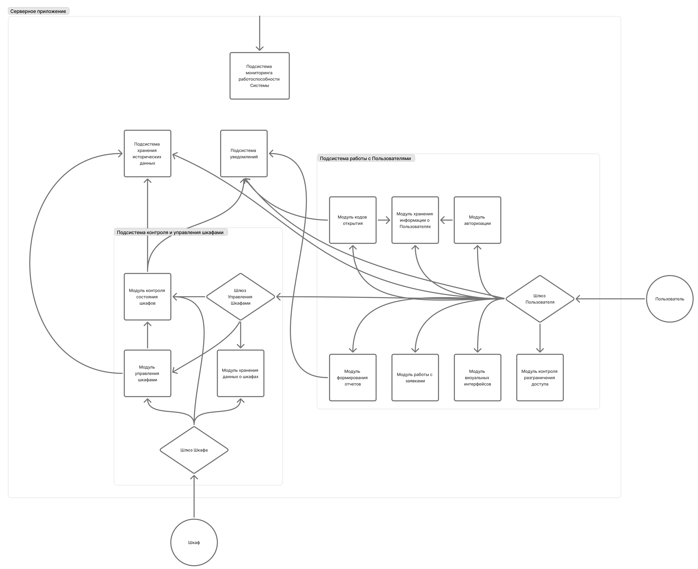

Архитектура решения
---

# Определения
- СКУД – совокупность всей аппаратной и программной части.
- Бэкенд – программная серверная часть СКУД.
- Фронтенд – пользовательские веб-интерфейсы. Доступ к ним получается через бэкенд.
- Контроллер – аппаратная часть СКУД, имеющий свой уникальный номер, и подключенные к ниму датчики.
- Система – совокупность программной и аппаратной частей СКУД.
- Допуск – наличие допуска означает что шкаф виден пользователю в списках Системы и что пользователь может его открыть.
  Отсутствие допуска скрывает шкаф: в списках возвращаются только шкафы с допуском.
  Операторы и администраторы видят все шкафы по роли, без допуска на каждый шкаф.
- Смежные организации – пользователи с временным допуском.
- Подрядные организации – пользователи с условно постоянным допуском.
- Ремонтная бригада – лица, занимающиеся только ремонтом или обслуживанием контроллера СКУД,
  имеют условно постоянный допуск в шкаф, и имеют с собой устройство аварийного открытия двери и тд.
- Расширение системы – Добавление в систему дополнительных датчиков.
- Взлом шкафа – несанкционированное проникновение в шкаф.
- Контроль работоспособности - мониторинг активности Шкафа и датчиков внутри него.
- Шлюз - программный интерфейс взаимодействия между подсистемами, а также бэкенда с пользователями и шкафами.

# Описание элементов
## 1. Пользователь
Лицо, имеющее учетную запись в Системе и доступ к её информационным ресурсам. (ГОСТ Р 71753-2024)

Может относиться к одному из следующих типов:
- Рабочий (иные обслуживающие компании):
  - открытие двери,
  - создание заявки на экстренное открытие двери.
- Оператор Системы (ЦОДД):
  - имеет все привелегии Рабочего,
  - осуществляет управление пользователями (добавить/удалить и тд.),
  - просмотр логов системы,
  - получение информации о взломе двери,
  - получение фото/видео материалов с камер (в случае НСД), получение информации с датчиков.
- Администратор Системы (Телеком инж.):
  - имеет все привелегии Оператора Системы,
  - контроль работоспособности Системы,
  - могут отключать оповещение о взломе двери,
  - могут добавлять новые контроллеры в Систему или удалять их,
  - настраивать систему при ее расширении.

## 2. Шкаф
Шкаф, где установлен Контроллер СКУД. Имеет уникальное название, пример: СО №777 или ЩУ ТОИ №777.
Дверь шкафа может быть открыта Пользователем посредством запроса к СКУД.

Все датчики в Шкафу имеют свои уникальные идентификаторы и серийные номера.

## 3. Подсистема работы с Пользователями
Обеспечивает программный интерфейс для взаимодействия с Пользователями.
Содержит в своем составе следующие модули:

### Шлюз Пользователя
Обеспечивает программный интерфейс Пользователя для выполнения действий в Системе.
Допустимость выполнения любого действия предварительно проверяется через 
[Модуль контроля разграничения доступа](#модуль-контроля-разграничения-доступа).
Собирает данные с других модулей, в частности
[Модуля хранения информации о Пользователях](#модуль-хранения-информации-о-пользователях)
и [Модуля кодов открытия](#модуль-кодов-открытия), для передачи их в
[Модуль контроля разграничения доступа](#модуль-контроля-разграничения-доступа).

### Модуль авторизации
Обеспечивает авторизацию Пользователей и выдачу им токенов для доступа к Системе.

Авторизация производится по паролю и коду из СМС.

Согласно требованиям ФСТЭК выделяется в отдельную подсистему.

### Модуль хранения информации о Пользователях
Хранит информацию о Пользователях, включая:
- Идентификатор;
- Номер телефона;
- ФИО;
- Название подрядной организации;
- Дата и время добавления;
- Дата и время начала действия допуска;
- Дата и время окончания действия допуска;
- Идентификатор Пользователя, создавшего запись;
- Номер последней заявки, на основании которой предоставлен доступ;
- Роль;
- Доступные для открытия шкафы (все или список);
- Данные для авторизации.

Позволяет получать, добавлять, удалять и редактировать информацию о Пользователях.

Информация, хранящаяся в этом модуле так же используется для авторизации пользователей.

Номер телефона является уникальным среди Пользователей, чей профиль есть в Системе и он не удален.

После окончания срока действия допуска автоматическое удаление не требуется. При этом у Оператора и
Администратора должна быть возможность получения списка Пользователей с истекшим сроком
действия допуска.

При продлении доступа указывается номер заявки, на основании которой продлевается доступ.

### Модуль кодов открытия
Отвечает за создание временных кодов открытия Шкафа. После создания код отправляется пользователю через
[Подсистему уведомлений](#6-подсистема-уведомлений).

Код имеет ограниченное заданное количество использований (на данный момент предусматривается 1), а так же
ограниценное время использования, после которого он становится недействителен.

Код привязан к идентификатору Шкафа и Пользователя.

### Модуль формирования отчетов
Формирует отчеты по данным [Подсистемы хранения исторических данных](#5-подсистема-хранения-исторических-данных)
и указанному фильтру.

Предполагаются отчеты в Excel, PDF. Конкретные форматы уточняеются отдельно.

Отчет хранится и доступен для скачивания по его идентификатору в течение некоторого заранее заданного времени
после формирования (думаю 3 часа вполне достаточно), после чего удаляется.

Отчет начинает формироваться по запросу Пользователя. После запроса состояние отчета (Формируется, Сформирован, Ошибка)
отправляется Пользователю по запросу. При успешном формировании отчет может быть скачан.

### Модуль работы с заявками
Обеспечивает доставку заявок от Пользователей до Операторов и Администраторов о необходимости
экстренного открытия Шкафа. Заявка может быть закрыта (удалена) Оператором или Администратором.
Заявка содержит:
- Идентификатор Пользователя, подавшего ее;
- Идентификатор Шкафа, на который подана заявка;
- Дата и время ее составления.

Заявки Оператор или Администратор получает по запросу.

Должен сохраняться лог действий с заявками.

### Модуль визуальных интерфейсов
Хранит информацию о веб-интерфейсах пользователей и выдает ее по запросу.

### Модуль контроля разграничения доступа
Содержит информацию о Модели разраничения доступа:
- роли;
- доступные действия в Системе;
- ограничения на действия в зависимости от контекста.

Выполняет проверку допустимости того или иного действия в рамках заложенной Модели на основании
контекста (информации о Пользователе, его привелегиях и состоянии системы).

## 4. Подсистема контроля и управления шкафами
Включает в себя модули для управления открытием/закрытием шкафов, а так же контроля их состояния на предмет соответствия
заданным критериям.

### Шлюз управления Шкафами
Обеспечивает программный интерфейс работы с Подсистемой 4. для компонентов Системы.
Проверки разграничения доступа не предполагается, ее выполняем на уровне внешних интерфейсов.

### Шлюз Шкафа
Обеспечивает программный интерфейс работы Шкафов с Системой. Выполняет аутентификацию шкафов с использованием
постоянного ключа. Через него Шкаф получает управляющие команды и в него же отправляет данные о своем состоянии.

### Модуль хранения данных о Шкафах
Хранит информацию о Шкафах, подключаемых к Системе, включая:
- Идентификатор (uuid);
- Инвентарный номер - строка вида СО №777 или ЩУ ТОИ №777;
- дата и время добавления;
- идентификатор пользователя, добавившего запись;
- информация о местоположении (адрес или точка на карте);
- данные для аутентификации;
- список контролируемых датчиков:
    - Идентификатор (uuid);
    - Серийный номер;
    - Тип.

### Модуль управления Шкафами
Обеспечивает доставку до шкафов управляющих команд. На данный момент речь идет про открытие и закрытие.

### Модуль контроля состояния Шкафов
Содержит и позволяет редактировать посредством программного интерфейса информацию о критериях допустимых
состояний шкафов в виде:
- интервалов значений датчиков;
- фиксировванных значений датчиков.

При выходе за рамки одного из указанных показателей, состояние считается небезопасным и Модуль
должен обеспечивать передачу информации об этом в [Подсистему 6](#6-подсистема-уведомлений).

Так же Модуль передает информацию о состоянии Шкафов и иных событиях безопасности в
[Подсистему 5](#5-подсистема-хранения-исторических-данных).

## 5. Подсистема хранения исторических данных
Обеспечивает хранение, доступ и аналитику данных Системы с привязкой ко времени их добавления.
Допустимы следующие виды данных:
- Значения датчиков Шкафов:
  - Идентификатор Шкафа.
  - Состояние двери – Закрыта/Открыта.
  - Состояние питания приходящего питания (есть/нет).
  - Состояние АКБ в процентах (0, 10, 20, … , 90, 100)
  - По какому каналу идет связь (GSM или Ethernet).
  - Датчик температуры и влажности – в градусах и процентах.
  - Датчик угла наклона – в градусах.
  - Датчик удара – сработал или нет (да/нет).
  - Датчик напряжения шкафа – в вольтах с возможностью выбора по одной или трем фазам выполняется
    мониторинг.
  - Ток потребления шкафа (с возможностью суммирования показателей за (неделю/месяц/год) и перевода в ватты,
    на основании датчика напряжения – вывод в амперах и ваттах.
  - Контроль целостности линии питания шкафа - да/нет.
  - Исполнительное устройство реле управления периферийным оборудованием: 
    состоит из четырех отдельно управляемых реле (Включить/Выключить/Перезагрузить).
- Фотографии с привязкой к Шкафу.
- Записи о переходе Шкафа в небезопасное состояние, включая:
  - Идентификатор Шкафа.
  - Параметры, по которым зафиксировано нарушение.
- Записи о командах, отправленных на Шкаф, включая:
  - Идентификатор Шкафа.
  - Название команды.
  - Идентификатор Пользователя, отправившего команду.

Хранение всех указанных данных должно обеспечиваться на срок от 2 лет. Набор значений может отличаться между шкафами
(на некоторых шкафах он будет меньше).

Предполагается обслуживание от 5000 Шкафов и получение данных с них раз в 30 секунд.

### Фильтрация
Система должна обеспечивать фильтрацию по времени событий, по идентификатору Шкафа и по идентификатору Пользователя
(где есть). 

### Аналитика
Должна быть возможность получения аггрегированных данных по отдельным показателям датчиков (набор показаний и способ
аггрегации согласуется отдельно).

## 6. Подсистема уведомлений
Обеспечивает создание, отправку и отмену уведомлений пользователям.

Все уведомления имеют идентификатор. Все уведомления имеют заданный текст.
Так же уведомлению может быть задан произвольный набор тэгов формата `ключ: значение`,
по которому может осуществляться фильтрация.

Предусматриваются следующие виды уведомлений:
- Периодические СМС-уведомления
  - Отправляется по СМС.
  - Задается периодичность (минуты).
  - Задается дата и время начала действия.
  - Указывается список номеров телефонов Пользователей, кому будет приходить это уведомление.
  - Уведомление будет отправляться, пока не будет отменено.
- Однократные СМС-уведомления
  - Отправляется по СМС.
  - Задается дата и время, после наступления которого осуществляется отправка.
  - Указывается список номеров телефонов Пользователей, кому будет приходить это уведомление.
- Постоянные уведомления
  - Могут быть получены внутри Системы.
  - Задается дата и время начала действия.
  - Указывается список ролей, либо список идентификаторов Пользователей, кому доступно уведомление.
  - Уведомление будет доступно, пока не будет отменено.

Подсистема предусматривает фильтрацию существующих уведомлений по:
- Идентификатору пользователя;
- Набору ролей, наличие в уведомлении роли из списка в фильтре;
- Заданным тэгам.

Отмена уведомления осуществляется по его идентификатору.

Тэги нужны для поиска уведомлений по произвольному набору аттрибутов, задаваемых подсистемами,
которые создают уведомление. Это позволяет понизить свзяность и увеличить гибкость Подсистемы.

# 7. Подсистема мониторинга работоспособности Системы
Хранит логи и метрики всех подсистем и модулей.

Среди основных метрик по каждой подсистеме, включая саму Подсистему 7:
- Количество запросов с разбивкой по коду ответа за секунду/минуту/час.
- Время ответа (50, 90, 95, 99 перцентили) за секунду/минуту/час.

# Маппинг подсистем на сервисы

Соответствие подсистем из требований выше и реальных сервисов в
`backend/services/`. Используется как мост между языком требований
и языком кода.

| Подсистема (требование)                                         | Сервис             | Порт  | Ключевые ответственности                                                                  |
|-----------------------------------------------------------------|--------------------|-------|-------------------------------------------------------------------------------------------|
| Управление пользователями, договорами, ролями (Подсистема 3)    | `user_api`         | 8000  | Users / contractors / access management; источник данных для ACM                          |
| Управление шкафами и устройствами (Подсистема 4)                | `locker_api`       | 8001  | Cabinet control, sensors, device MQTT gateway (relay boards via Mosquitto)                |
| История событий и телеметрии (Подсистема 5)                     | `history_api`      | 8002  | Telemetry storage, security events, помесячное партиционирование                          |
| Аутентификация и сессии (Модуль авторизации в Подсистеме 3)     | `auth_api`         | 8003  | OTP, JWT-токены, управление сессиями                                                      |
| Контроль разграничения доступа (Модуль контроля разграничения)  | `acm`              | 8004  | Role-based rule engine, TTL-кэш; read-only поверх `scud_users`                            |
| Уведомления (Подсистема 6)                                      | `notification_api` | 8005  | СМС и in-system уведомления, фоновый шедулер                                              |
| Отчёты и выгрузки                                               | `reports_api`      | 8006  | Асинхронная генерация отчётов (.xlsx), очередь задач в собственной БД `scud_reports`; исходные данные тянет по HTTP из `history_api` / `user_api` (не читает чужие БД) |
| API gateway (Шлюз Пользователя / Шлюз управления Шкафами)       | Apache + mod_lua   | 80    | Reverse proxy, валидация JWT в Lua, инъекция `X-Remote-User` / `X-Remote-Role`            |

Используется паттерн **database-per-service**: шесть PostgreSQL 15 на портах
5432–5437 (`scud_users`, `scud_lockers`, `scud_history`, `scud_auth`,
`scud_notifications`, `scud_reports`). У ACM собственной БД нет — он читает
`scud_users` в режиме read-only.
